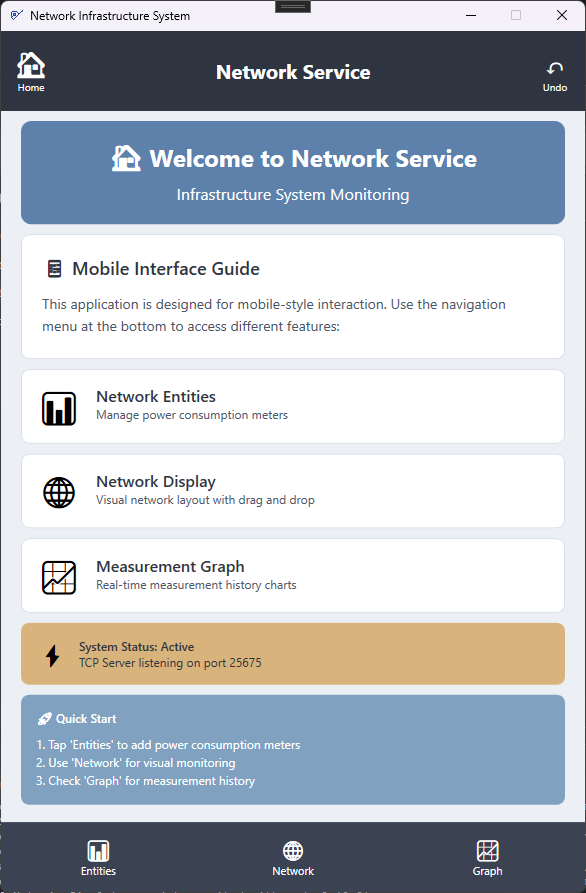
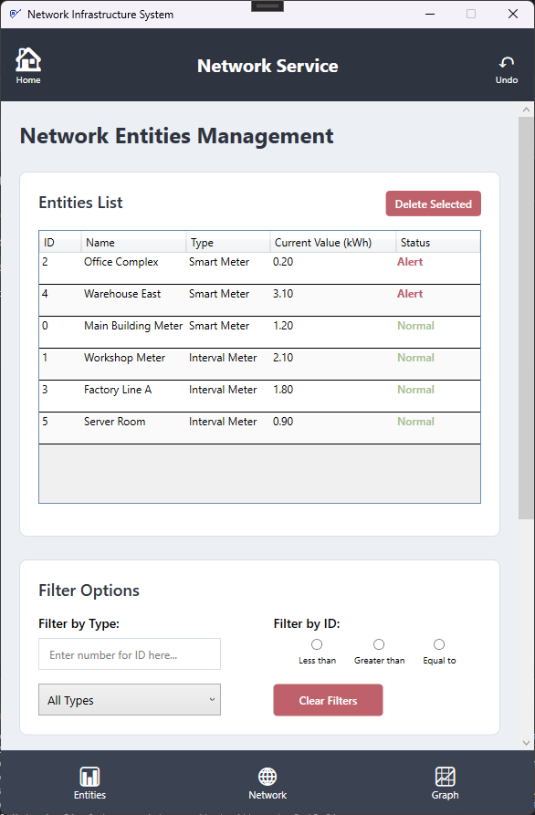
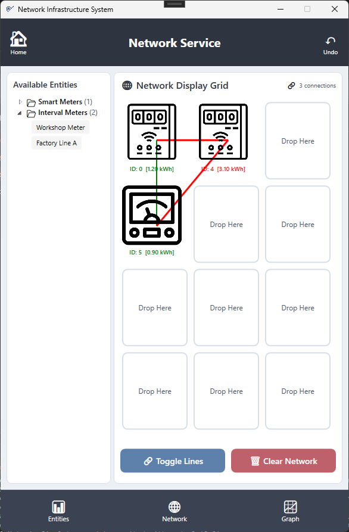
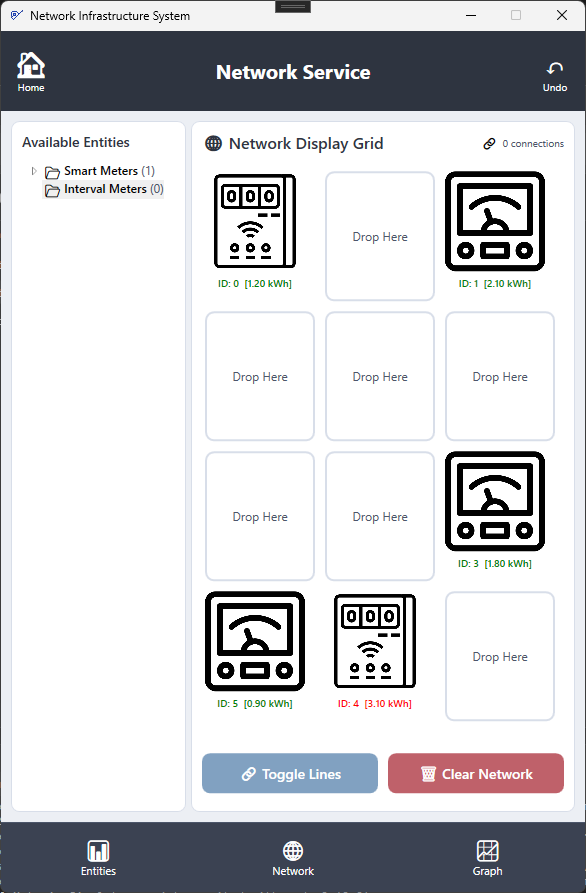
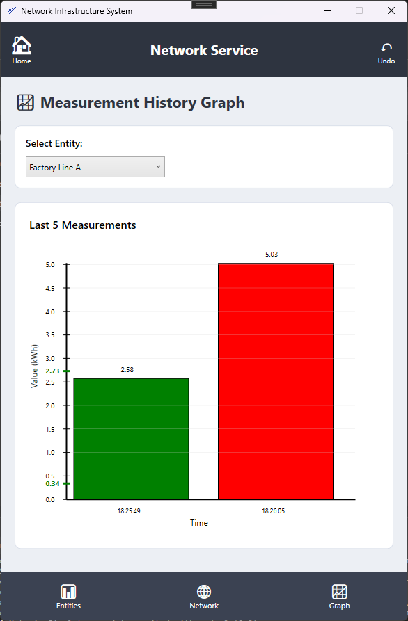
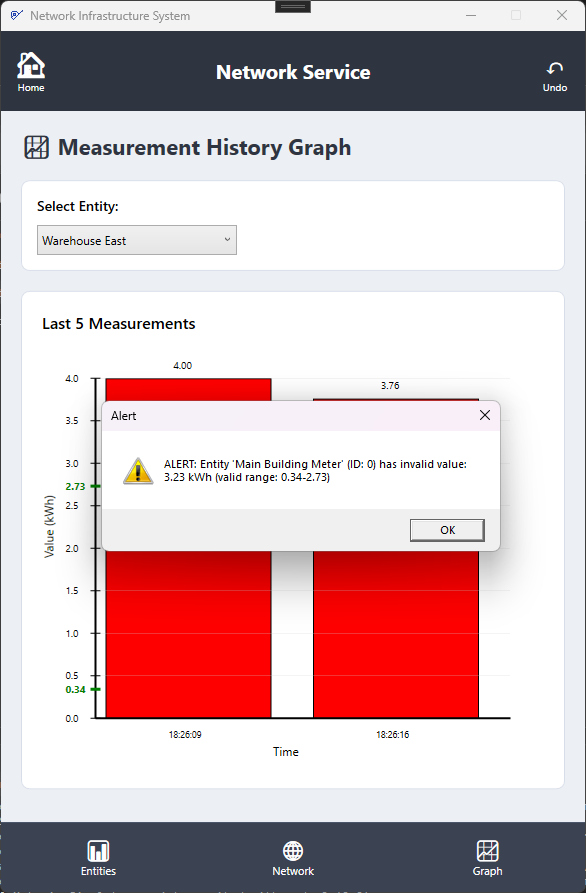
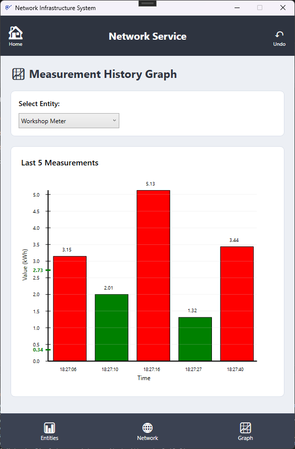

# Network Service

A desktop application for monitoring electricity consumption and managing a network of meters. The project includes the **Network Service** WPF application and a separate **Metering Simulator** that sends simulated readings.

## Features

- Add, view, and filter smart meters and interval meters
- Visualize the meter network and connect meters by dragging them into the grid
- View measurement history charts and alerts for values outside the allowed range
- Exchange readings with the simulator over TCP on port `25675`
- Undo the most recent action in the main application

## Technologies

- C# and WPF
- .NET Framework 4.7.2
- TCP communication over `localhost:25675`

## Getting started

Open `NetworkService/NetworkService/NetworkService.sln` in Visual Studio and run the **NetworkService** project. The simulator is in `MeteringSimulator/MeteringSimulator.sln`; run it alongside the main application to send simulated readings.

## Screenshots

| Home screen | Meter management |
|:--:|:--:|
|  |  |

| Network with connections | Network layout |
|:--:|:--:|
|  |  |

| Measurement history | Invalid reading alert |
|:--:|:--:|
|  |  |

| Additional measurement history view |
|:--:|
|  |
